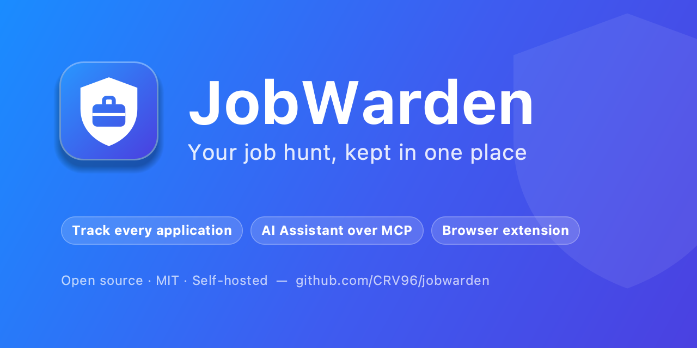

<p align="center">
  
</p>

<p align="center">
  <b>The keeper of your job hunt.</b><br>
  Save job postings from your browser in one click, and keep every application's story, from the first save to the
  offer. Self-hosted, in 8 languages, with the AI assistant you already have.
</p>

<p align="center">
  <a href="https://github.com/CRV96/jobwarden/actions/workflows/ci.yml"></a>
  <a href="https://sonarcloud.io/summary/overall?id=CRV96_job_tracker"></a>
  <a href="https://sonarcloud.io/component_measures?id=CRV96_job_tracker&metric=coverage"></a>
  <a href="https://coderabbit.ai"></a>
  <a href="LICENSE.md"></a>
  <a href="https://discord.gg/A4U2eVNck"></a>
</p>
<h3 align="center">Support project</h3>
<p align="center">
  <a href="https://www.buymeacoffee.com/robertciapa"></a>
  <a href="https://revolut.me/robertcrv"></a>
</p>

<h4 align="center">Guides</h4>
<p align="center">
  <a href="https://github.com/CRV96/jobwarden/wiki/Installation">Install</a> ·
  <a href="https://github.com/CRV96/jobwarden/wiki/Getting-started">Get started</a> ·
  <a href="https://github.com/CRV96/jobwarden/wiki">Wiki</a> ·
  <a href="https://github.com/CRV96/jobwarden/wiki/Browser-extension">Browser extension</a> ·
  <a href="https://discord.gg/A4U2eVNck">Discord</a>
</p>

## What it does

- **Every job in one place.** Save postings from Chrome or Firefox with the
  [browser extension](https://github.com/CRV96/jobwarden/wiki/Browser-extension), and follow each one on a timeline, a pipeline and a
  calendar, with reminders, statistics and CSV import and export.
- **Never the same job twice.** Open a posting you've seen before and the extension says so at once: ★ bookmarked,
  ✓ applied, on its toolbar icon and in its popup.
- **Finds jobs for you.** Your AI assistant searches for jobs that fit your CV, the watchlist reads the job boards of the
  companies you'd work for, and the Search Builder writes the queries for Google, LinkedIn, Reddit and X.
- **Applies better.** A CV tailored to each posting, cover letters, messages to the people hiring, a fit score,
  interview prep from your own stories, and Auto-apply in your own browser.
- **Reads your inbox.** Recruiters' replies become updates of the right job: rejections, interviews, offers.
- **Weighs offers.** Your offers side by side, what the market pays from three sources, and a brief to negotiate.
- **Yours.** It runs on your computer, with your data in your own PostgreSQL. Its AI runs on Claude Code or Codex, on
  your own plan: JobWarden needs no API key, and sends nothing anywhere.

## Quick start

With Docker ([how to install it](https://github.com/CRV96/jobwarden/wiki/Installing-Docker), on a Mac, Windows, Linux, a
Raspberry Pi or a NAS), in a folder for JobWarden:

```bash
curl -L -o compose.yaml https://github.com/CRV96/jobwarden/releases/latest/download/compose.yaml
docker compose up -d
```

and open <http://localhost:9273>. On Windows, in PowerShell, write `curl.exe` instead of `curl`.
[Installation](https://github.com/CRV96/jobwarden/wiki/Installation) has the other ways, from the sources included;
[Getting started](https://github.com/CRV96/jobwarden/wiki/Getting-started) the five minutes after.

## Documentation

Everything is in the **[wiki](https://github.com/CRV96/jobwarden/wiki)**:

| Run it | Use it | Build it |
|---|---|---|
| [Installing Docker](https://github.com/CRV96/jobwarden/wiki/Installing-Docker) | [Tracking jobs](https://github.com/CRV96/jobwarden/wiki/Tracking-jobs) | [What's what](https://github.com/CRV96/jobwarden/wiki/Architecture) |
| [Installation](https://github.com/CRV96/jobwarden/wiki/Installation) | [Finding jobs](https://github.com/CRV96/jobwarden/wiki/Finding-jobs) | [Development](https://github.com/CRV96/jobwarden/wiki/Development) |
| [Getting started](https://github.com/CRV96/jobwarden/wiki/Getting-started) | [Your CV and applying](https://github.com/CRV96/jobwarden/wiki/CV-and-applying) | [Contributing](CONTRIBUTING.md) |
| [Updating](https://github.com/CRV96/jobwarden/wiki/Updating) | [Offers and salaries](https://github.com/CRV96/jobwarden/wiki/Offers-and-salaries) | [Security](SECURITY.md) |
| [Configuration](https://github.com/CRV96/jobwarden/wiki/Configuration) | [AI assistant](https://github.com/CRV96/jobwarden/wiki/AI-assistant) | [Changelog](CHANGELOG.md) |
| [Operations](https://github.com/CRV96/jobwarden/wiki/Operations) | [Browser extension](https://github.com/CRV96/jobwarden/wiki/Browser-extension) | |

The wiki's pages live in [docs/wiki](docs/wiki), so they change in pull requests with the code.

## Code quality

<p align="center">
  <a href="https://sonarcloud.io/summary/overall?id=CRV96_job_tracker"></a>
</p>

<p align="center">
  <a href="https://sonarcloud.io/component_measures?id=CRV96_job_tracker&metric=security_rating"></a>
  <a href="https://sonarcloud.io/project/issues?id=CRV96_job_tracker&impactSoftwareQualities=SECURITY"></a>
  <a href="https://sonarcloud.io/component_measures?id=CRV96_job_tracker&metric=sqale_rating"></a>
</p>
<p align="center">
  <a href="https://sonarcloud.io/component_measures?id=CRV96_job_tracker&metric=coverage"></a>
  <a href="https://sonarcloud.io/component_measures?id=CRV96_job_tracker&metric=duplicated_lines_density"></a>
  <a href="https://sonarcloud.io/component_measures?id=CRV96_job_tracker&metric=ncloc"></a>
</p>

Every pull request is checked before it merges: [SonarQube Cloud](https://sonarcloud.io/summary/overall?id=CRV96_job_tracker)'s
quality gate on the code and what the tests cover, CodeQL's code scanning, the dependency review, and a
[CodeRabbit](https://coderabbit.ai) review. [SECURITY.md](SECURITY.md#how-the-project-is-checked) has the rest.

## Community

- **Questions, and what's being worked on:** the [Discord server](https://discord.gg/A4U2eVNck).
- **Ideas:** the [Ideas discussions](https://github.com/CRV96/jobwarden/discussions/categories/ideas), where others vote
  for them. **Suggest a feature**, in the app's profile menu, opens one with your version filled in.
- **Bugs:** [GitHub Issues](https://github.com/CRV96/jobwarden/issues/new/choose), with the steps to reproduce.
- **Vulnerabilities:** in private, as [SECURITY.md](SECURITY.md) says.

## Contributing

See [CONTRIBUTING.md](CONTRIBUTING.md). Contributions require agreeing to the Contributor License Agreement described
there. To talk a change over first, ask on [Discord](https://discord.gg/A4U2eVNck).

## License

[MIT](LICENSE.md): use it, change it and share it, as long as the copyright notice and the license stay with it. It
comes without any warranty.
