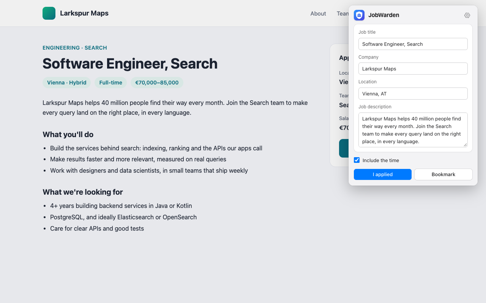
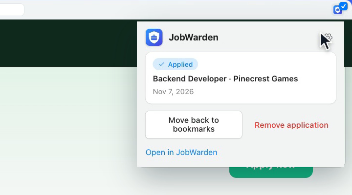

# Browser extension

The **JobWarden extension** for Chrome and Firefox saves the job posting you're looking at to your JobWarden in one
click, and shows on its toolbar icon whether a page is already saved. It's the
[`extension/`](https://github.com/CRV96/jobwarden/tree/main/extension) folder of the repository: plain JavaScript and
Manifest V3, with no build step.

## Install

  
  &nbsp;&nbsp;
  

  
  

1. Add it from its store: the [Chrome Web Store](https://chromewebstore.google.com/detail/bjklifdmffkhiffbicofeohgdcpmobek)
   for Chrome, Edge, Brave, Opera and the other Chromium browsers, or
   [Firefox Add-ons](https://addons.mozilla.org/firefox/addon/jobwarden/) for Firefox (140 or later). JobWarden's
   **Settings → Browser extension** has both buttons too, as does the setup guide in the profile menu.
2. In the extension's settings (⚙ in its popup, or **Options** in its menu), enter your server's address (e.g.
   `http://localhost:9273`; the browser asks you to allow any other) and your **profile ID**, which JobWarden's
   **Settings → Your profile** shows with a button to copy it.

The stores update the extension on their own. The popup says when your server runs a newer version than the extension.

### From the sources

For a version that isn't in the stores yet, or one you changed:

1. Get the extension: the `jobwarden-extension-<version>.zip` of the [release](https://github.com/CRV96/jobwarden/releases)
   with your server's version (**Settings → About** says which), unzipped; or the `extension/` folder of a clone.
2. **Chrome** (and Edge, Brave...): open `chrome://extensions`, turn on **Developer mode**, click **Load unpacked** and pick
   that folder. **Firefox**: open `about:debugging#/runtime/this-firefox`, click **Load Temporary Add-on…** and pick its
   `manifest.json`. Firefox keeps it until it restarts.

**Updating** one from the sources: replace the folder with the new release's (or `git pull`), then click the extension's
reload button in `chrome://extensions` (in Firefox, `about:debugging`). The browser reads `manifest.json` only then, so
an option that needs a new permission can't be turned on before; the settings page says so.

## What it does

On a job posting, click the extension's icon. It looks the page up in JobWarden first:

- **Not saved yet:** it reads the posting (the title, company, place, salary, description and the company's logo), which
  you can correct, then **I applied** or **Bookmark**.
- **Bookmarked** (★): **I applied**, or remove the bookmark.
- **Applied** (✓): move it back to the bookmarks, for an application you didn't send, or remove it.
- **Further along:** **Open in JobWarden**.

It also watches a company from its job board on Greenhouse, Lever, Ashby, SmartRecruiters, Workable, Recruitee or
Personio (the eye beside ⚙, see the [watchlist](Finding-jobs#watchlist)), can put ★ or ✓ on the toolbar icon of every tab showing a saved posting, and can
bring the [reminders](Tracking-jobs#reminders) set on the calendar as your system's notifications.

## Never the same job twice

The same job comes back again and again: in searches, in job alerts, posted again on another board. The extension
remembers it for you, so you don't read it twice, or apply twice.

- **On the toolbar icon, as soon as a posting opens:** a grey ★ if you bookmarked it, a ✓ if you applied, in the colour
  of where it stands: blue applied, orange interviewing, green offer, red rejected. Turn it on in the extension's
  settings: **Show on the toolbar icon whether a page is already in JobWarden**. The browser asks you to let the
  extension see your tabs' addresses, and each page you open is then looked up on your own server, and nowhere else.
- **In the popup, always:** instead of the form to save it again, the job's status and its date, with
  **Open in JobWarden**.

It knows a job by its posting's own link, without the tracking parameters job boards add, and finds that link even on a
search page that shows the job: the same job, found twice, is the same job.

It reads most job boards and career sites from the schema.org `JobPosting` they publish for Google's job search, and
LinkedIn, Indeed, Glassdoor, Greenhouse, Workday, pracuj.pl, InfoJobs and BestJobs from what the page shows. It keeps
one application per posting: it drops tracking parameters from links, and saves a job's own link even from a search
page.

## The server's side

The extension talks to the server's **capture API**, under `/api/captures` (`jobwarden.capture.path`), and to nothing
else:

| Call | What |
|---|---|
| `GET /profile?key=` | The profile a profile ID names |
| `POST /` | Saves a posting (`"action"`: `BOOKMARK` or `APPLY`), with the site's icon as a `data:image/png;base64,...` URL in `icon` and the company logo's address in `logoUrl` |
| `GET ?userId=&link=` | Looks a link up: 204 when it isn't saved |
| `POST /{id}/move-back-to-saved` | Takes back "I applied" |
| `DELETE /{id}?userId=` | Removes an application |
| `POST /reminders/due?userId=` | The reminders due, which it takes |
| `GET /watchlist?userId=&link=` | Whether a page is on a Greenhouse, Lever, Ashby, SmartRecruiters, Workable, Recruitee or Personio board, and whether the company is watched (204 when it isn't on one) |
| `POST /watchlist`, `DELETE /watchlist/{companyId}?userId=` | Watches a company, or stops |
| `GET /version` | The server's version and the latest release, which the popup compares with its own |

Each call on an application answers with its current state: its id, title, company, status, and when it got that
status. Errors are [RFC 9457](https://www.rfc-editor.org/rfc/rfc9457) problem details with an `errorCode`, in the
language of the request's `Accept-Language`. The API allows the extensions' origins (`chrome-extension://`,
`moz-extension://`) and never web pages (CORS). The server downloads a company's logo itself, from the public internet
only, never from its own machine or network.

## Versions and languages

The extension's version is the server's: one release carries both, and
[VersionTests](https://github.com/CRV96/jobwarden/blob/main/app/src/test/java/com/jobwarden/VersionTests.java) fails when
they differ. Its popup says when a newer JobWarden is out, and when the server already runs a newer version than the
extension.

Its texts are in `extension/_locales/<language>/messages.json`, in JobWarden's languages: pages name them with
`data-i18n="key"`, scripts with `message('key')`.
[ExtensionMessagesTests](https://github.com/CRV96/jobwarden/blob/main/app/src/test/java/com/jobwarden/ExtensionMessagesTests.java)
checks that every language has every text and that every text named exists. ESLint checks its JavaScript with the
pages', on `./mvnw verify` (in `web/`, `npm run lint`).

## Privacy

The extension talks only to the server entered in its settings: [PRIVACY.md](https://github.com/CRV96/jobwarden/blob/main/PRIVACY.md)
says what it sends and when.
